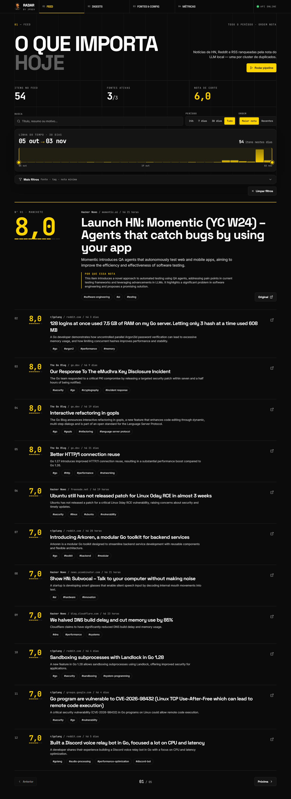
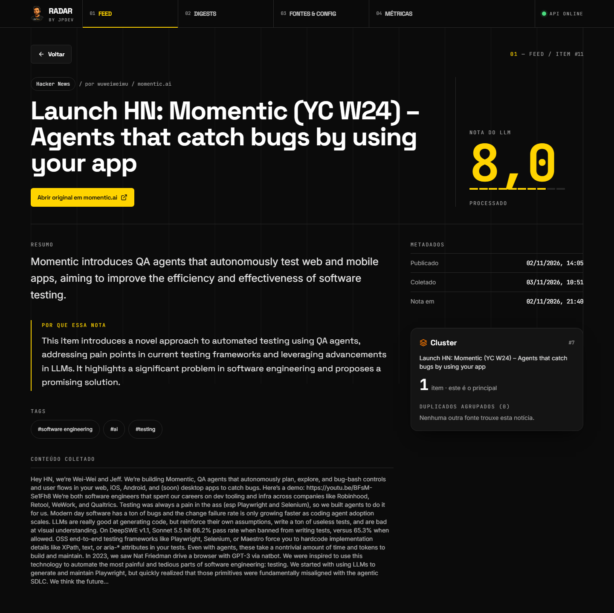
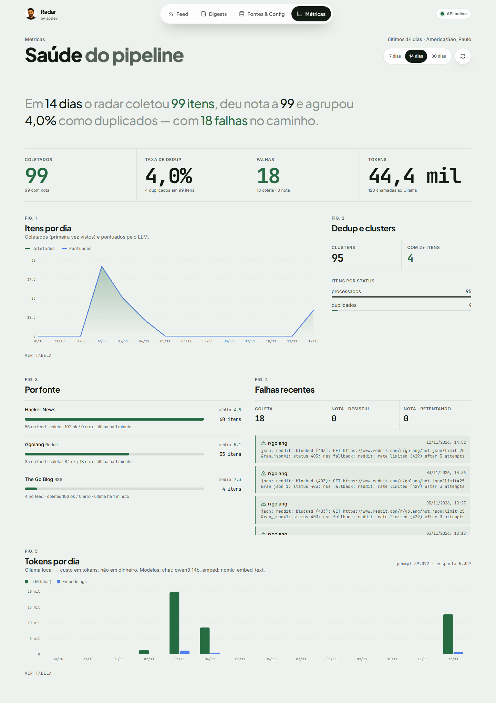

# Horizon Web — Radar by JpDev

Dashboard Vue 3 do **Horizon**, agregador de notícias tech com nota por LLM local, dedup semântico
e digest diário. Vue 3 + Vite + TypeScript + Pinia + Vue Router + Tailwind CSS v4, com e2e em
Playwright. Consome só a API real do backend em Go,
**[horizon-go](https://github.com/Joao-Pedro-AI-Visionary/horizon-go)**; não há mock nem dado fixo no front.

*Vue 3 + TypeScript frontend for Horizon (AI news aggregator). The Go backend lives in
[horizon-go](https://github.com/Joao-Pedro-AI-Visionary/horizon-go).*

Este repositório era a pasta `web/` do monorepo horizon-go e foi separado com o histórico de
commits preservado.

| Feed | Detalhe/Cluster | Métricas |
|---|---|---|
|  |  |  |

## Como rodar contra o horizon-go

Requisitos: Node 24 e o backend [horizon-go](https://github.com/Joao-Pedro-AI-Visionary/horizon-go)
rodando (API em `:8080`, worker, Postgres, NATS e Ollama; no Windows, `.\scripts\start-local.ps1`
no repo do backend).

```bash
npm ci
npm run dev        # Vite em http://localhost:5173; /api e /healthz vão por proxy para HORIZON_API_URL
npm run build      # vue-tsc -b + vite build (saída em dist/)
npm run preview    # serve o build em http://localhost:4173, com o mesmo proxy
```

Configuração (copie `.env.example` para `.env` se precisar mudar algo):

| Variável | Padrão | Para que serve |
|---|---|---|
| `HORIZON_API_URL` | `http://localhost:8080` | Alvo do proxy de `/api` e `/healthz` no `vite dev`/`vite preview` e checado pelo Playwright antes de rodar. `API_TARGET` ainda é aceito. |
| `VITE_API_URL` | vazio | Origem da API chamada direto pelo navegador (entra no build). Vazio mantém URLs relativas `/api` via proxy. Se usar, libere a origem do front em `HORIZON_CORS_ORIGINS` no horizon-go. |

## Testes e vídeos

```bash
npm run e2e        # Playwright em desktop 1440x900, tablet 834x1112, mobile 390x844 (sobe vite preview em :4173)
E2E_BASE_URL=http://localhost:5173 npx playwright test   # contra um Vite já rodando
```

O e2e exige o backend no ar em `HORIZON_API_URL` (o `e2e/global-setup.ts` checa `/healthz` e falha
com uma mensagem clara se não estiver). No Windows, `.\scripts\e2e.ps1` roda a suíte e gera
`videos/e2e-<project>.mp4` (`scripts/videos.mjs`, FFmpeg); com `-Demo` também grava o tour
`demo/tour.spec.ts` em `videos/demo-final.mp4`. `.\scripts\narrated.ps1` gera o vídeo narrado em pt-BR
(roteiro em `videos/narrated/script.md`). Os testes que alteram dados apagam a fonte que criam e
restauram as configurações no final. Os screenshots de cada tela ficam em
`docs/screenshots/<tela>-<viewport>.png`; `node scripts/before-after.mjs` monta o antes/depois.
Decisões de design e motion em [`docs/DESIGN.md`](docs/DESIGN.md).

## Telas

| Rota | Tela | Endpoints |
|---|---|---|
| `/` | Feed: cards com a nota em destaque, scrubber de datas sobre o histograma diário, período e ordem em segmentados, "Mais filtros" (fonte, tag, nota mínima) em disclosure, busca, paginação (filtros na URL) e "Rodar pipeline" | `GET /api/feed`, `GET /api/feed/timeline`, `GET /api/sources`, `GET /api/settings`, `POST /api/pipeline/run` |
| `/items/:id` | Detalhe/Cluster: resumo, motivo da nota, tags, conteúdo, metadados, cluster e duplicados com similaridade, link original | `GET /api/items/{id}` |
| `/digests/:date?` | Digests: lista por data, leitura do HTML num iframe sandbox, download do Markdown e "Gerar agora" | `GET /api/digests`, `GET /api/digests/{date}?format=html\|md`, `POST /api/digests/generate` |
| `/sources` | Fontes & Config: criar, editar, ativar/desativar, excluir (com confirmação) e "Coletar agora"; nota de corte, máximo de itens, cota por fonte, cron e fuso | `GET/POST /api/sources`, `PATCH/DELETE /api/sources/{id}`, `POST /api/sources/{id}/fetch`, `GET/PUT /api/settings` |
| `/metrics` | Métricas: KPIs, itens/dia, por fonte, dedup e status, falhas recentes, tokens/dia | `GET /api/metrics?days=7\|14\|30` |

Layout: sidebar a partir de 1280px, rail de ícones entre 768 e 1279px e bottom nav abaixo
de 768px. O indicador de saúde vem de `GET /healthz`.

## Decisões de design

- **Identidade JpDev**: fundo `#0B0B0B`, superfícies `#141414`/`#1C1C1C`, amarelo `#FFD400`
  em CTAs, item ativo da navegação e nota; laranja `#FF7A00` só em badges de duplicado e alertas.
  O site usa `public/jpdev-avatar.webp` (foto atual do GitHub) como logo, com `favicon-32.png` e
  `apple-touch-icon.png` derivados dela. `public/jpdev-logo.png`, cópia byte a byte de
  `assets/jpdev-logo.png` do horizon-go (mesmo SHA-256), ficou só para os vídeos (`scripts/`, `narrated/`).
- **Fontes self-hosted** via `@fontsource-variable` (Space Grotesk, Inter, JetBrains Mono),
  sem chamada ao Google Fonts.
- **Gráficos em SVG próprio** (`components/BarChart.vue`), sem dependência: barras finas com
  2px de respiro, cantos de 4px, grade recessiva, legenda, tooltip por hover/foco e uma tabela
  com os mesmos dados ("Ver tabela"). A 2ª série usa `#4F8DF7`; o par amarelo/azul passou no
  validador de paleta (separação CVD ΔE 37,6, contraste ≥ 3:1 sobre `#141414`). O amarelo da
  marca fica fora da faixa de luminosidade recomendada para séries; foi mantido por identidade,
  e a legenda e a tabela garantem que nada dependa só da cor.
- **Acessibilidade**: foco visível amarelo em todo controle, link "Pular para o conteúdo",
  `aria-current` na navegação, `aria-label` em botões só de ícone, alvos ≥ 44px, `<dialog>` nativo
  para formulário e confirmação, toasts em região `aria-live`, `prefers-reduced-motion` respeitado.
  O texto secundário `#A3A3A3` tem contraste de 7,3:1 sobre `#141414`.
- **Estados reais**: skeleton durante o carregamento, vazio com ação útil e erro com a mensagem
  da API e "Tentar de novo". Erros de validação (400) aparecem junto ao formulário.
- Todas as ações têm `data-testid`.

## Referências do Dribbble

Encontradas por busca ("dark dashboard bento grid", "news aggregator dashboard dark") em
2026-11-02. Os links abaixo são as páginas dos shots; nada foi copiado. Foram usados como
padrão de layout, não como fonte de pixels. Limitação: as referências foram escolhidas pelo
título e pela descrição de cada shot no resultado da busca; as imagens não foram inspecionadas
uma a uma, então a coluna da direita registra o padrão que aplicamos inspirado em cada uma.

| Referência | O que foi aproveitado |
|---|---|
| [Analytics UI components — bento grid design, Naimur Rahman](https://dribbble.com/shots/25096075-Analytics-Ui-components-bento-grid-design) | KPIs em tiles do mesmo tamanho no topo e gráfico principal ocupando 3/4 da linha (tela de Métricas) |
| [Bento grid & dark mode designs, Naavyd](https://dribbble.com/shots/23353521-Bento-grid-dark-mode-designs) | Cards escuros com borda fina e cantos grandes (16px) em vez de sombra |
| [Bento grid & dashboard for revops startup, Robin Holesinsky](https://dribbble.com/shots/25765472-Bento-grid-dashboard-for-revops-startup) | Blocos de tamanhos diferentes na mesma grade (dedup ao lado do gráfico; por fonte e falhas lado a lado) |
| [Bento Grid — Dashboard UI Widgets, Jigar Fotaria](https://dribbble.com/shots/22968599-Bento-Grid-Dashboard-UI-Widgets) | Número grande em fonte mono como herói do tile, com legenda curta abaixo |
| [AI News Aggregator App, Hasan Mahmud](https://dribbble.com/shots/23806625-AI-News-Aggregator-App) | Card de notícia com metadados (fonte · domínio · tempo) acima do título e tags em chips |
| [Dark UI — News Feed dashboard, Iza Bulska](https://dribbble.com/shots/2730818-Dark-UI-News-Feed-dashboard) | Feed em grade de duas colunas no desktop com filtros fixos acima |

## Créditos e licença

Parte do Horizon-Go, reescrita em Go + Vue 3 do [Horizon](https://github.com/Thysrael/Horizon)
© 2026 Thysrael, licença MIT. Licença **MIT**, mantida do upstream: veja [`LICENSE`](LICENSE)
(copyright Thysrael 2026 + JpDev) e [`NOTICE`](NOTICE).
